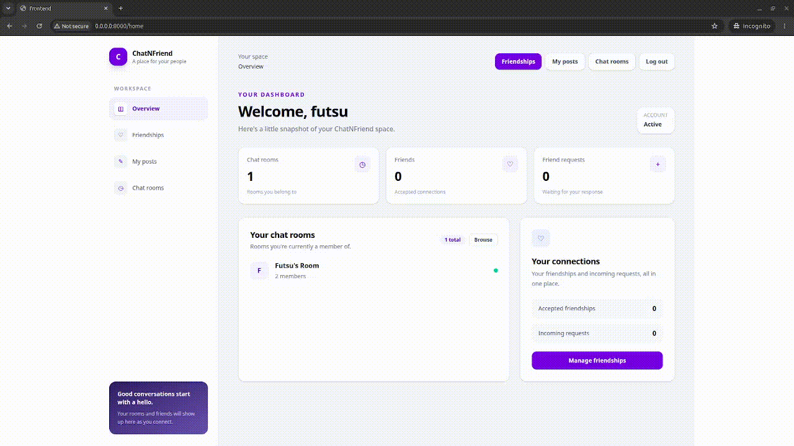

# ChatNFriend

ChatNFriend is a full-stack social app for finding people, sharing posts, and chatting in rooms. It was built as a backend-focused learning project, with particular attention to WebSockets, automated tests, and containerized deployment.

## Project focus and AI assistance

The main learning focus for this project was backend development, especially WebSockets, multi-worker message delivery with Redis Pub/Sub, database integration, testing, and containerization. Most of the frontend was built with AI assistance. I used the project to prioritize learning and implementing the backend systems behind the app.

## Features

- JWT-based account registration and login
- User profiles
- Friendship requests and friend management
- Posts and comments
- Public room discovery, room creation, and membership
- Room message history and live messaging over WebSockets
- Message redaction and deletion by the author or a superuser
- Redis Pub/Sub to distribute new, edited, and deleted message events across backend workers
- PostgreSQL-backed persistent data

## Technology

### Backend

- Python 3.14
- FastAPI
- SQLModel, SQLAlchemy, and Alembic
- PostgreSQL
- Redis (async client and Pub/Sub)
- pytest

### Frontend

- React and TypeScript
- Vite
- TanStack Router and TanStack Query
- Hey API-generated API client
- Tailwind CSS

### Infrastructure

- Docker and Docker Compose
- Bun for building the frontend
- `uv` for Python dependencies

## Video showcase

```markdown
[]
```

## Run with Docker Compose

Prerequisites: Docker Engine and the Docker Compose plugin.

1. Clone the repository and enter its directory:

   ```bash
   git clone https://github.com/futsu37/ChatNFriend.git ChatNFriend
   cd ChatNFriend
   ```

2. Create and configure the environment file:

   ```bash
   cp .env.example .env
   ```

   Edit `.env` before starting the application. In particular replace the example `SECRET_KEY` and passwords with private values. Do not commit `.env`. The provided Compose configuration uses the service names `db` and `redis` for container-to-container connections.

3. Validate the Compose configuration and build/start the services:

   ```bash
   docker compose config --quiet
   docker compose up --build -d
   ```

   Compose starts PostgreSQL and Redis, runs the database prestart task, and
   then starts the backend. The backend image builds and serves the frontend.

4. Open the application:

   - App: <http://localhost:8000>
   - Swagger UI: <http://localhost:8000/docs>
   - OpenAPI schema: <http://localhost:8000/openapi.json>
   - Health check: <http://localhost:8000/api/v1/health-check/>

   The first configured superuser is created from
   `FIRST_SUPERUSER_USERNAME` and `FIRST_SUPERUSER_PASSWORD` in `.env`.

Useful commands:

```bash
# Follow backend logs
docker compose logs -f backend

# Stop services (named database and Redis volumes are preserved)
docker compose down

# Stop services and delete persisted database and Redis data
docker compose down -v
```

## Configuration

The root `.env.example` lists the variables used by Docker Compose and the
backend, including:

- `SECRET_KEY` and `ACCESS_TOKEN_EXPIRE_MINUTES` for authentication
- `POSTGRES_SERVER`, `POSTGRES_PORT`, `POSTGRES_USER`, `POSTGRES_PASSWORD`,
  and `POSTGRES_DB` for PostgreSQL
- `FIRST_SUPERUSER_USERNAME` and `FIRST_SUPERUSER_PASSWORD` for initial
  superuser setup
- `REDIS_HOST` and `REDIS_PORT` for Redis
- `DOCKER_IMAGE_BACKEND`, `TAG`, and `FRONTEND_HOST` for Compose/deployment
  configuration

Inside Docker Compose, the backend reaches Redis at `redis:6379` and PostgreSQL
at `db:5432`. If running the backend directly on your host, configure the
database and Redis host values to addresses reachable from the host.

The optional `frontend/.env.example` contains `VITE_API_URL` for frontend
development outside the combined Docker image. The Docker build defaults this
to the same origin as the served app.

## Development

The simplest way to run the complete application is Docker Compose, as above.
For frontend-only development:

```bash
cd frontend
bun install
cp .env.example .env
bun run dev
```

The Vite dev server is available at <http://localhost:5173>. Make sure the
backend is running at the URL configured by `VITE_API_URL`.

## Tests and checks

Backend tests are in `backend/tests` and use pytest. From the backend directory:

```bash
cd backend
uv sync
mkdir -p src/backend/frontend
uv run pytest
```

The backend app initializes Redis during startup, so Redis must be reachable
using the configured `REDIS_HOST` and `REDIS_PORT` when running the tests. The
`mkdir` command creates the static frontend directory expected by the app during
local test startup; the Docker image includes the built frontend already.

Frontend checks:

```bash
cd frontend
bun install
bun run lint
bun run build
```

## Real-time chat notes

Messages are stored in PostgreSQL. Redis Pub/Sub carries live message-created,
-updated, and -deleted events between backend workers; each worker forwards
those events to the room WebSockets connected to that worker.

Redis Pub/Sub does not retain events for disconnected clients. When a client
reconnects, it loads message history from the API, which reads from PostgreSQL.
